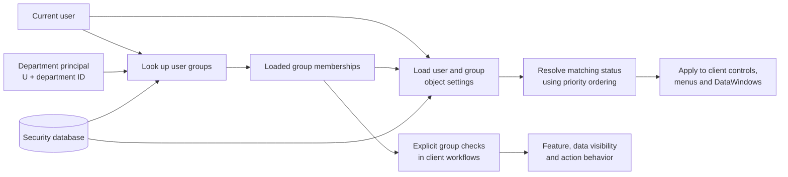
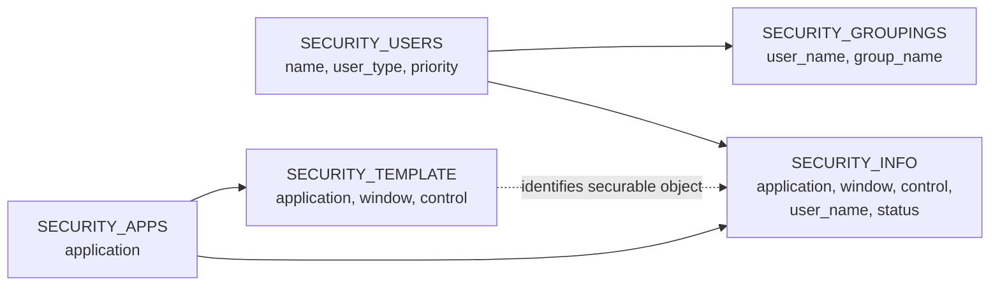
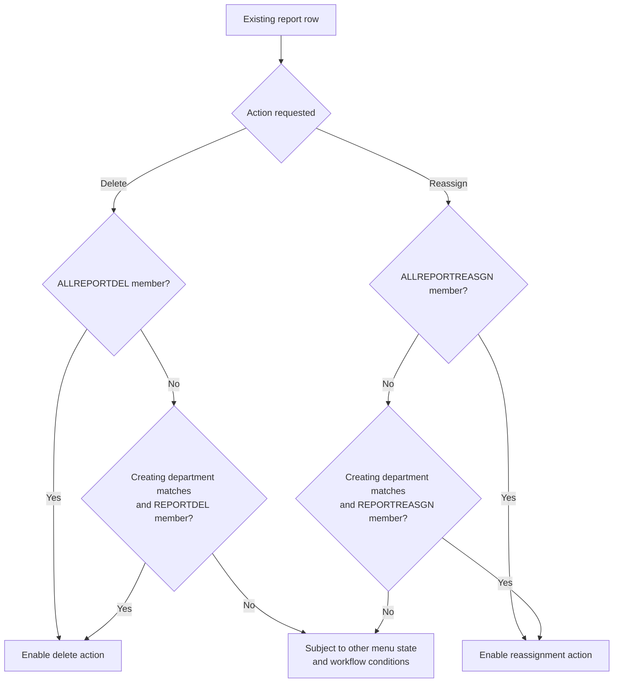

# CERS Client Authorization and Permissions

## Purpose and scope

This document describes the authorization model visible in the CERS Client
source code. It is intended for application maintainers, security
administrators, and reviewers who need to understand how group membership and
object permissions are used by the client.

The repository contains the client-side security implementation and references
to the security database schema. It does **not** contain a current export of
users, group memberships, or configured permission records. Accordingly, this
document describes the model and the group keys found in source; it is not a
statement of who currently has access in any environment.

## Executive summary

CERS uses two related authorization mechanisms:

1. **Object permissions** are stored against an application, window, control,
   and user or group. The PFC security service applies these settings to
   windows, menus, controls, and DataWindow columns.
2. **Named group checks** in application code enable, restrict, or tailor
   specific features and data operations. Code tests membership using
   `of_IsGroupMember("GROUP_KEY")`.

The application models people and groups in `SECURITY_USERS`, membership in
`SECURITY_GROUPINGS`, and per-object decisions in `SECURITY_INFO`. Group names
are therefore the closest source-visible equivalent to roles. The source does
not define a single authoritative role catalog or describe all business
meanings of those group names.

## Visual overview

The diagram distinguishes configured object permissions from the independent
group checks embedded in client workflows. Both can affect the same screen;
membership alone does not establish a complete effective permission.



### Security data relationships

The relationships below describe fields used by the client, not verified
database constraints. `SECURITY_USERS` contains both users and groups; each
`SECURITY_INFO.USER_NAME` identifies the user or group to which a setting
applies.



## Authorization model

### Security initialization

At application startup, the CERS application manager initializes
`n_cst_security_cers` using the active database transaction, application name,
user ID, default group, and a precache setting. Initialization:

1. Confirms the database transaction is connected.
2. Looks up the application and user in the security data.
3. Retrieves the user's group memberships.
4. Retrieves and appends group memberships assigned to a synthetic
   department principal whose user key is `U<department id>`.
5. Checks the default group when the department-principal retrieve returns
   zero. The code overwrites the earlier retrieve's count before that check;
   this is not a documented guarantee that both lookups found no memberships.
6. Preloads permissions when precaching is enabled; otherwise, permissions
   are retrieved as secured windows are accessed. The CERS startup call
   specifies `default` and enables precaching.

The CERS initialization call is in
[`n_cst_appmanager_cers.sru`](ws_objects/cersbase2/cersbase2.pbl.src/n_cst_appmanager_cers.sru).
The implementation and return codes are in
[`n_cst_security_cers.sru`](ws_objects/cersbase2/cersbase2.pbl.src/n_cst_security_cers.sru).
The shared PFC implementation is in
[`pfc_n_cst_security.sru`](ws_objects/pfcapsrv/pfcapsrv.pbl.src/pfc_n_cst_security.sru).

### Security data model

The client source refers to these database tables and fields:

| Table | Source-visible purpose |
|---|---|
| `SECURITY_APPS` | Registered applications and descriptions. |
| `SECURITY_USERS` | User and group records. `USER_TYPE` is `0` for a user and `1` for a group; group priority is used when resolving object permissions. |
| `SECURITY_GROUPINGS` | Links a user name to a group name. |
| `SECURITY_TEMPLATE` | Catalog of application windows and controls, including object type and description. |
| `SECURITY_INFO` | A status for a user or group on an application/window/control combination. |

The source locations include
[`d_pfcsecurity_userlookup.srd`](ws_objects/security/CersVersion/pfeapsrv.pbl.src/d_pfcsecurity_userlookup.srd),
[`d_pfcsecurity_grouplookup.srd`](ws_objects/security/CersVersion/pfeapsrv.pbl.src/d_pfcsecurity_grouplookup.srd),
[`d_pfcsecurity_controllist.srd`](ws_objects/security/CersVersion/pfeapsrv.pbl.src/d_pfcsecurity_controllist.srd),
and
[`d_pfcsecurity_templateupdate.srd`](ws_objects/security/CersVersion/pfeapsrv.pbl.src/d_pfcsecurity_templateupdate.srd).

## Permission statuses

Object permission records use one-character status values:

| Code | Meaning | Client behavior |
|---|---|---|
| `E` | Enabled | Enables and makes the applicable control visible. |
| `D` | Disabled | Disables the applicable control and makes it visible. |
| `I` | Invisible | Disables and hides the applicable control. |
| `N` / empty | Not set | No explicit status is applied by `of_SetState`; the control's existing state is left unchanged. |

The shared PFC constants define `E`, `D`, `I`, and the empty status. The
administration data window presents the corresponding labels in
[`d_pfcsecurity_info_update.srd`](ws_objects/security/CersVersion/pfcsecad.pbl.src/d_pfcsecurity_info_update.srd).

### Permission lookup and precedence

Permission records are retrieved for the current user and their groups. The
result set includes the associated `SECURITY_USERS.PRIORITY` and is sorted by
control and ascending priority. The permission lookup methods use the first
matching row after sorting. Therefore, **the lower numeric priority is
considered first** by this implementation.

The source shows user and group records being combined, but does not document
the intended priority convention for ties or specify a complete precedence
contract between direct user records and group records. Confirm configured
priorities and tie behavior with the security-data owners before relying on a
particular override rule.

Some workflows add their own rules. For example, the FSI helper combines
`FSI_RO` and `FSI_ACT` membership with a specific user-level object status;
see
[`n_cst_security_cers.sru`](ws_objects/cersbase2/cersbase2.pbl.src/n_cst_security_cers.sru).

`of_SetSecurity` applies object settings to client UI objects. Separate
`of_IsGroupMember` checks implement business-feature gates. A UI status alone
should not be treated as proof that a server-side operation is protected; the
source reviewed here does not establish all downstream service or database
authorization behavior.

## Source-observed group keys and permissions

The following **49 distinct literal group keys** were found in uncommented
`of_IsGroupMember` calls in the exported PowerBuilder source. The table shows
representative source behavior, not an exhaustive permissions matrix or
official role definitions. Checks may depend on row state, user, department,
other groups, or object permissions. In particular, membership does not
always grant access: `ATTN`, `EVTV`, and `MULN` are examples of restrictive
checks. Confirm each key and its assignments with the security-data owners.

| Group key | Apparent source use |
|---|---|
| `ACT_DEL` | Activity deletion actions. |
| `ADMADDTXTNOTIF` | Administrative addition of text to notifications. |
| `ADMTRANS` | Administrative transaction actions in note-related workflows. |
| `ALLEVTACC` | Broad event access checks in event, notification, and search workflows. |
| `ALLNEV` | Retrieves all non-event messages rather than only the department's messages. |
| `ALLNOTIFYGRPS` | Passes an all-access flag when retrieving notification groups. |
| `ALLREPORTACC` | Broad report access checks. |
| `ALLREPORTDEL` | Broad report deletion actions. |
| `ALLREPORTREASGN` | Broad report reassignment actions. |
| `ATSFD` | Allows `.sfd` attachments in the attachment selection/validation workflow. |
| `ATTN` | Hides and disables attachment-opening actions in several lists. |
| `ATTR` | Enables attachment reassignment when a row is selected. |
| `CABINASAPADM` | Cabin ASAP administration-related workflows. |
| `CERS_PII_DATA` | Visibility of employee/person demographic information. |
| `CKCREWDTLRO` | Shows selected crew-detail fields; its name suggests read-only access. |
| `CKCREWDTLUPDT` | Shows selected crew-detail fields; its name suggests update access. |
| `COGRPTUSER` | Report-related behavior in the main CERS frame. |
| `CORRACTTAB` | Corrective-action tab behavior. |
| `DISPASAPADM` | Dispatcher ASAP administration-related workflows. |
| `DSIFTUSER` | Daily sift user-specific behavior. |
| `EVTD` | Enables the event-delete menu action. |
| `EVTV` | Applies view-only restrictions in event and notification workflows. |
| `FLAG_WEB_SRVCS` | Web-service-related application behavior. |
| `FSI_ACT` | FSI activity/action access. |
| `FSI_RO` | FSI read-only access. |
| `GRANTACCALL` | Granting broad access in notification workflows. |
| `GRANTACCATT` | Allows attachment access management for records created by the user's department, subject to row state. |
| `GRANTACCATTALL` | Allows attachment access management without the department condition, subject to row state. |
| `GRANTACCEVT` | Granting event-related access in notification workflows. |
| `GRANTACCNOTE` | Allows note access management for notes created by the user's department, subject to row state. |
| `GRANTACCNOTEALL` | Allows note access management without the department condition, subject to row state. |
| `GRANTACCRPT` | Allows report access management for reports created by the user's department, subject to row state. |
| `GRANTACCRPTALL` | Allows report access management without the department condition, subject to row state. |
| `IODRPTVIEW` | Viewing IOD reports. |
| `MASAPADM` | ASAP administration-related workflows; business meaning of the prefix requires confirmation. |
| `MEAAview` | A view-related check in event handling. |
| `MULN` | Restricts company preference to the user's company and disables multi-company mode. |
| `NOTA` | Enables note deletion in the relevant note workflow. |
| `NOTEREASSIGN` | Note reassignment. |
| `PASAPADM` | ASAP administration-related workflows; business meaning requires confirmation. |
| `PILOTASAPADM` | Pilot ASAP administration-related workflows; distinct from `PASAPADM`. |
| `PROXYUSER` | Proxy-user behavior in the CERS frame. |
| `REPORTDEL` | Enables report deletion when the creating department matches in the relevant menu workflow. |
| `REPORTREASGN` | Enables report reassignment when the creating department matches in the relevant menu workflow. |
| `RESTARTAPPS` | Shows the Sabre and mail restart controls in application properties. |
| `RISKASSMT` | Risk assessment behavior. |
| `RISKTAB` | Risk tab access. |
| `RISKTABRO` | Read-only risk tab access. |
| `SCHS` | Enables the safety update action in search/list workflows. |

Examples of source call sites include
[`u_dw_activity.sru`](ws_objects/cersbase2/cersbase2.pbl.src/u_dw_activity.sru),
[`u_tabpg_note.sru`](ws_objects/cersbase2/cersbase2.pbl.src/u_tabpg_note.sru),
[`w_event.srw`](ws_objects/cers2/cers2.pbl.src/w_event.srw),
[`w_search.srw`](ws_objects/cers2/cers2.pbl.src/w_search.srw), and
[`w_frame_cers.srw`](ws_objects/cers2/cers2.pbl.src/w_frame_cers.srw).

This catalog covers literal checks in the searched source files, using both
single- and double-quoted arguments. It excludes commented-out checks and does
not include values only present in runtime data or authorization enforced
outside this repository.

### Dynamically configured group checks

The application also reads group names from application configuration for
`all_attachment_access_group`, `all_note_access_group`, and
`all_report_access_group`, then checks membership in those groups. Their
actual group names are environment data, not literal role names in this
source. See
[`n_cst_appmanager_cers.sru`](ws_objects/cersbase2/cersbase2.pbl.src/n_cst_appmanager_cers.sru).

### Example: report permissions

The following represents one client menu workflow; it is not a universal
decision tree for all report operations.



See
[`u_dw_activity.sru`](ws_objects/cersbase2/cersbase2.pbl.src/u_dw_activity.sru)
for the surrounding row-state and menu logic.

## Administration and reporting

The repository includes a PFC security administration client. Its menu
provides:

- **Users/Groups** management.
- **Templates** for registered securable objects.
- **Users/Objects** management for per-object settings.
- **Users** and **Objects** security reports.
- **Scan Application** to discover application objects for the security
  template.

The menu is defined in
[`m_pfcsecurity_master.srm`](ws_objects/security/CersVersion/pfcsecad.pbl.src/m_pfcsecurity_master.srm).
The relevant management windows include
[`w_pfcsecurity_usermgmt.srw`](ws_objects/security/CersVersion/pfcsecad.pbl.src/w_pfcsecurity_usermgmt.srw)
and
[`w_pfcsecurity_infomgmt.srw`](ws_objects/security/CersVersion/pfcsecad.pbl.src/w_pfcsecurity_infomgmt.srw).

## Operational review checklist

To produce an authoritative environment-specific access review:

1. Export group records from `SECURITY_USERS` (`USER_TYPE = 1`) and membership
   records from `SECURITY_GROUPINGS`.
2. Export `SECURITY_INFO` with its application, window, control, user/group,
   status, and related priority.
3. Verify the configured default group and memberships of the synthetic
   department principal `U<department id>` used by CERS initialization.
4. Compare every active group key listed above with the exported group
   catalog; investigate unknown, unused, and similarly named groups.
5. Confirm the group's business owner, intended membership, status, and
   priority with the application/security owner.
6. Review any authorization performed by web services, APIs, and database
   procedures separately; the client source does not establish their complete
   enforcement model.

### Read-only inventory queries

Run these queries only with authorized read-only access against the intended
environment. They return configured records, **not calculated effective
access**. Memberships of the synthetic department principal and dynamic group
configuration must also be considered.

```sql
-- Configured groups and their priorities.
SELECT name, description, priority
FROM security_users
WHERE user_type = 1
ORDER BY priority, name;

-- Configured group memberships, including department principals.
SELECT user_name, group_name
FROM security_groupings
ORDER BY user_name, group_name;

-- Explicit user/group object settings and their configured priority.
SELECT i.application, i.window, i.control, i.user_name,
       u.user_type, u.priority, i.status
FROM security_info i
LEFT JOIN security_users u ON u.name = i.user_name
ORDER BY i.application, i.window, i.control, u.priority, i.user_name;

-- Known securable objects, including those without an explicit setting.
SELECT application, window, control, object_type, description
FROM security_template
ORDER BY application, window, control;
```

## Source files

- CERS security service:
  [`n_cst_security_cers.sru`](ws_objects/cersbase2/cersbase2.pbl.src/n_cst_security_cers.sru)
- CERS application initialization:
  [`n_cst_appmanager_cers.sru`](ws_objects/cersbase2/cersbase2.pbl.src/n_cst_appmanager_cers.sru)
- PFC security service:
  [`pfc_n_cst_security.sru`](ws_objects/pfcapsrv/pfcapsrv.pbl.src/pfc_n_cst_security.sru)
- Security administration menu:
  [`m_pfcsecurity_master.srm`](ws_objects/security/CersVersion/pfcsecad.pbl.src/m_pfcsecurity_master.srm)
